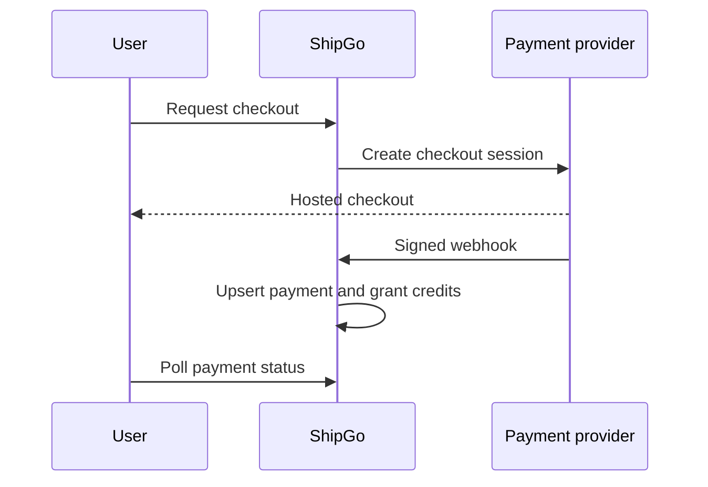

`PAYMENT_PROVIDER` selects Stripe or Creem. Product and price IDs are configured
through environment variables, while plan behavior lives in
`src/config/business-config.ts`.

ShipGo supports plan checkout, credit-package checkout, customer portals,
payment status polling, subscriptions, lifetime plans, idempotent webhooks, and
payment notifications.

Credits support registration gifts, monthly refreshes, package purchases,
subscription renewals, lifetime monthly grants, usage, and expiration. The
cron endpoint requires `CRON_SECRET`; manual distribution uses:

```bash
pnpm distribute-credits
```

Always replay signed staging webhook fixtures before a production release.

## Webhooks and idempotency

Webhook endpoints:

- `/api/webhooks/stripe`
- `/api/webhooks/creem`

Invalid signatures return 400, retryable processing failures return 500, and
duplicate events return 200 without granting credits again. Billing order external
invoice IDs (`shipgo_billing_order.external_invoice_id`) are the idempotency boundary.

Credit changes use transactions. Consumption is FIFO by expiration and creation
time. Scheduled distribution calls `/api/cron/credits` with Basic Auth using
`CRON_SECRET`.

## Configure a provider

1. Choose `PAYMENT_PROVIDER=stripe` or `PAYMENT_PROVIDER=creem`.
2. Create products and prices in the provider's test environment.
3. Put server price IDs in `.env.local`; put public pricing IDs in matching `VITE_` variables.
4. Keep amounts and intervals aligned in `src/config/business-config.ts` (from which `src/config/payment-config.ts` derives).
5. Configure the provider API key, signed webhook secret, and webhook URL.
6. Complete a test checkout and confirm the local payment record changes.

Never pair live API keys with test price IDs, or test API keys with live price IDs.

## Payment flow



The signed webhook is the source of truth. The browser redirect improves user experience but must not grant access by itself.

## Plans, packages, and maintenance

Plans live in `businessConfig.plans`; purchasable credit bundles live in `businessConfig.creditPackages`. A package needs a provider price ID before `/api/credit/packages` exposes it.

Call scheduled maintenance from your hosting platform:

```bash
curl -X POST -H "Authorization: Basic $CRON_SECRET" \
  https://example.com/api/cron/credits
```

Use `pnpm distribute-credits` for a trusted manual run.

## Pre-launch payment test

- Complete subscription, lifetime, and credit-package checkouts in test mode.
- Replay the same webhook and confirm there is no duplicate grant.
- Open the customer portal, cancel a test subscription, and return to ShipGo.
- Confirm invalid signatures return `400` and retryable failures return `500`.
- Confirm the user can see payment state and credit history.
