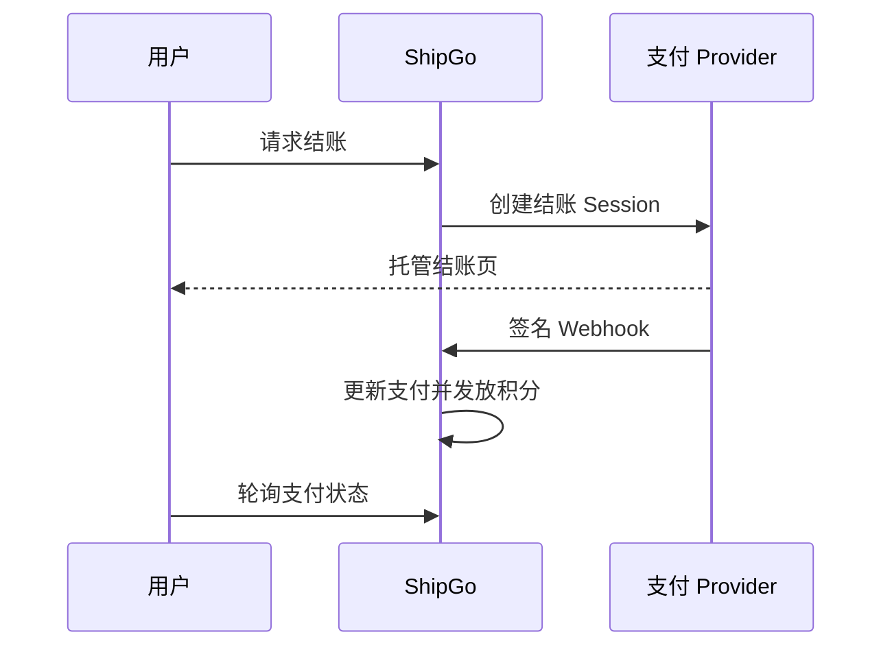

`PAYMENT_PROVIDER` 用于选择 Stripe 或 Creem。产品与价格 ID 通过环境变量配置，
套餐业务规则位于 `src/config/business-config.ts`。

ShipGo 支持套餐结账、积分包结账、Customer Portal、支付状态轮询、订阅、终身套餐、
幂等 Webhook 与支付通知。

积分支持注册赠送、月度刷新、积分包购买、订阅续费、终身套餐月度发放、使用与过期。
Cron 接口要求 `CRON_SECRET`，手动发放命令为：

```bash
pnpm distribute-credits
```

生产发布前必须使用有效签名在预发布环境回放 Webhook Fixture。

## Webhook 与幂等

Webhook 端点：

- `/api/webhooks/stripe`
- `/api/webhooks/creem`

签名无效返回 400，可重试处理失败返回 500，重复事件返回 200 且不会再次发放积分。
账单外部发票 ID（`shipgo_billing_order.external_invoice_id`）是幂等边界。

积分变更使用事务。扣减按过期时间和创建时间 FIFO。计划任务通过 Basic Auth 和
`CRON_SECRET` 调用 `/api/cron/credits`。

## 配置支付 Provider

1. 选择 `PAYMENT_PROVIDER=stripe` 或 `PAYMENT_PROVIDER=creem`。
2. 在 Provider 测试环境创建产品与价格。
3. 将服务端价格 ID 写入 `.env.local`，将公开定价 ID 写入对应 `VITE_` 变量。
4. 保持 `src/config/business-config.ts` 中的金额和周期配置一致（`src/config/payment-config.ts` 会自动从其派生）。
5. 配置 Provider API Key、签名 Webhook Secret 与 Webhook URL。
6. 完成测试结账，并确认本地支付记录发生变化。

绝不能把正式 API Key 与测试价格 ID 混用，也不能把测试 API Key 与正式价格 ID 混用。

## 支付流程



签名 Webhook 是事实来源。浏览器重定向用于改善体验，但绝不能单独授予权限。

## 套餐、积分包与维护

套餐位于 `businessConfig.plans`，可购买积分包位于 `businessConfig.creditPackages`。积分包配置 Provider 价格 ID 后，`/api/credit/packages` 才会公开它。

使用部署平台的 Scheduler 调用维护任务：

```bash
curl -X POST -H "Authorization: Basic $CRON_SECRET" \
  https://example.com/api/cron/credits
```

可信手动执行使用 `pnpm distribute-credits`。

## 上线前支付测试

- 在测试模式完成订阅、终身套餐和积分包结账。
- 重放同一 Webhook，确认不会重复发放。
- 打开客户门户、取消测试订阅并返回 ShipGo。
- 确认无效签名返回 `400`，可重试失败返回 `500`。
- 确认用户可以看到支付状态与积分历史。
