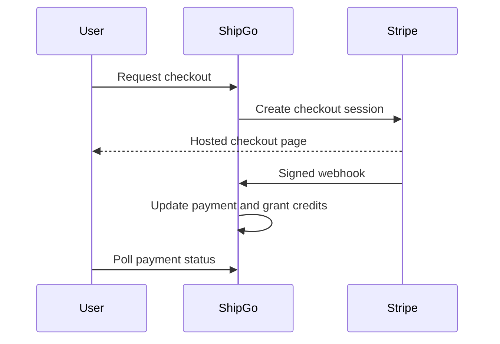

Stripe is the default payment provider in ShipGo.

## Configuration

1. Set `PAYMENT_PROVIDER=stripe` in `.env.local`.
2. Create products and prices in the Stripe test environment.
3. Write server-side price IDs into `.env.local` and public pricing IDs into the
   matching `VITE_` variables.
4. Keep `src/config/business-config.ts` amounts and billing periods consistent
   (`src/config/payment-config.ts` derives its pricing model from it).
5. Configure the Stripe API key, webhook signing secret, and webhook URL.
6. Complete a test checkout and confirm that local payment records update.

Never mix live API keys with test price IDs, or test API keys with live price
IDs.

### Required environment variables

| Variable | Purpose |
| --- | --- |
| `STRIPE_SECRET_KEY` | Server-side API authentication |
| `STRIPE_WEBHOOK_SECRET` | Validate webhook signatures |
| `STRIPE_PRO_MONTHLY_PRICE_ID` | Pro monthly plan price |
| `STRIPE_PRO_YEARLY_PRICE_ID` | Pro yearly plan price |
| `STRIPE_LIFETIME_PRICE_ID` | Lifetime plan price |
| `STRIPE_CREDIT_BASIC_PRICE_ID` | Basic credit package |
| `STRIPE_CREDIT_STANDARD_PRICE_ID` | Standard credit package |
| `STRIPE_CREDIT_PREMIUM_PRICE_ID` | Premium credit package |
| `STRIPE_CREDIT_ENTERPRISE_PRICE_ID` | Enterprise credit package |
| `VITE_STRIPE_PRO_MONTHLY_PRICE_ID` | Browser-side Pro monthly price |
| `VITE_STRIPE_PRO_YEARLY_PRICE_ID` | Browser-side Pro yearly price |
| `VITE_STRIPE_LIFETIME_PRICE_ID` | Browser-side Lifetime price |

## Payment processing flow



Signed webhooks are the source of truth. Browser redirects improve UX but must
never be the sole authorization for granting credits or updating plan status.

## Webhook endpoint

Stripe webhooks are received at:

```
POST /api/webhooks/stripe
```

- Invalid signatures return `400`.
- Retryable processing failures return `500`.
- Duplicate events return `200` without granting credits again.

Billing order external invoice IDs (`shipgo_billing_order.external_invoice_id`) are the idempotency boundary.

## Credits and one-time payments

Credit changes use transactions. Consumption is FIFO by expiration and creation
time.

- **Registration gift**: granted on first signup.
- **Monthly refresh**: recurring free credits.
- **Package purchases**: one-time credit packages bought through checkout.
- **Subscription renewals**: credits granted on each renewal.
- **Lifetime monthly grants**: recurring credits for lifetime plan holders.

The cron endpoint `/api/cron/credits` requires Basic Auth using `CRON_SECRET`.
Operators can also run `pnpm distribute-credits` manually.

## Testing checklist

- Complete subscription, lifetime, and credit package checkouts in test mode.
- Replay the same webhook and confirm no duplicate credits.
- Open the customer portal, cancel a test subscription, and return to ShipGo.
- Confirm invalid signatures return `400`.
- Confirm retryable failures return `500`.
- Confirm users can see payment status and credit history.
