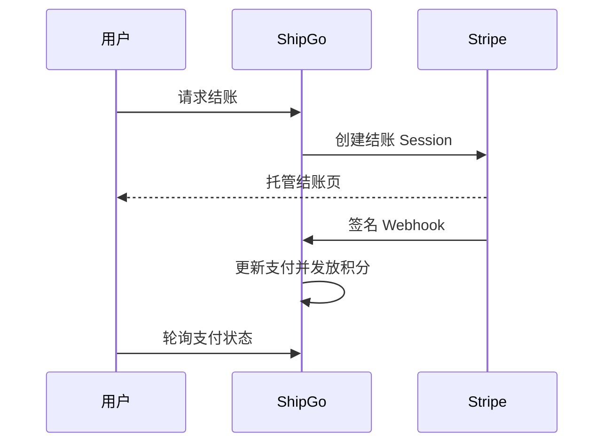

Stripe 是 ShipGo 的默认支付 Provider。

## 配置

1. 在 `.env.local` 中设置 `PAYMENT_PROVIDER=stripe`。
2. 在 Stripe 测试环境创建产品与价格。
3. 将服务端价格 ID 写入 `.env.local`，将公开定价 ID 写入对应 `VITE_` 变量。
4. 保持 `src/config/business-config.ts` 的金额和周期配置一致（`src/config/payment-config.ts`
   会自动从其派生）。
5. 配置 Stripe API Key、Webhook 签名 Secret 与 Webhook URL。
6. 完成测试结账，并确认本地支付记录发生变化。

绝不能把正式 API Key 与测试价格 ID 混用，也不能把测试 API Key 与正式价格 ID 混用。

### 必需环境变量

| 变量 | 用途 |
| --- | --- |
| `STRIPE_SECRET_KEY` | 服务端 API 认证 |
| `STRIPE_WEBHOOK_SECRET` | 验证 Webhook 签名 |
| `STRIPE_PRO_MONTHLY_PRICE_ID` | Pro 月度套餐价格 |
| `STRIPE_PRO_YEARLY_PRICE_ID` | Pro 年度套餐价格 |
| `STRIPE_LIFETIME_PRICE_ID` | 终身套餐价格 |
| `STRIPE_CREDIT_BASIC_PRICE_ID` | 基础积分包 |
| `STRIPE_CREDIT_STANDARD_PRICE_ID` | 标准积分包 |
| `STRIPE_CREDIT_PREMIUM_PRICE_ID` | 高级积分包 |
| `STRIPE_CREDIT_ENTERPRISE_PRICE_ID` | 企业积分包 |
| `VITE_STRIPE_PRO_MONTHLY_PRICE_ID` | 浏览器端 Pro 月度价格 |
| `VITE_STRIPE_PRO_YEARLY_PRICE_ID` | 浏览器端 Pro 年度价格 |
| `VITE_STRIPE_LIFETIME_PRICE_ID` | 浏览器端终身套餐价格 |

## 支付处理流程



签名 Webhook 是事实来源。浏览器重定向用于改善体验，但绝不能单独授予权限。

## Webhook 端点

Stripe Webhook 接收地址：

```
POST /api/webhooks/stripe
```

- 签名无效返回 `400`。
- 可重试处理失败返回 `500`。
- 重复事件返回 `200` 且不会再次发放积分。

账单外部发票 ID（`shipgo_billing_order.external_invoice_id`）是幂等边界。

## 积分与一次性付费

积分变更使用事务。扣减按过期时间和创建时间 FIFO。

- **注册赠送**：首次注册时发放。
- **月度刷新**：周期性免费积分。
- **积分包购买**：通过结账购买的一次性积分包。
- **订阅续费**：每次续费时发放积分。
- **终身套餐月度发放**：终身套餐持有者的周期性积分。

Cron 端点 `/api/cron/credits` 要求使用 `CRON_SECRET` 的 Basic Auth。运维人员也可以
运行 `pnpm distribute-credits` 手动发放。

## 测试清单

- 在测试模式完成订阅、终身套餐和积分包结账。
- 重放同一 Webhook，确认不会重复发放。
- 打开客户门户、取消测试订阅并返回 ShipGo。
- 确认无效签名返回 `400`。
- 确认可重试失败返回 `500`。
- 确认用户可以看到支付状态与积分历史。
