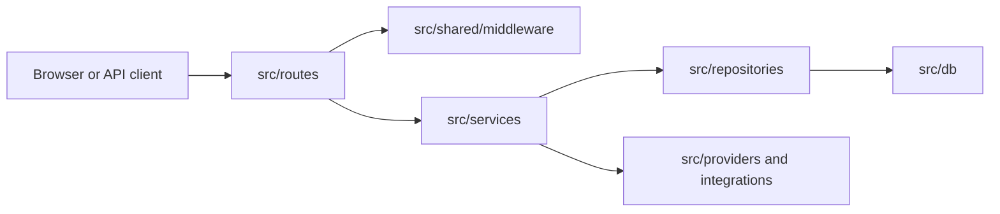

ShipGo is a full-stack TypeScript application built on TanStack Start. Product
behavior stays inside services and repositories, while external systems remain
behind provider interfaces.

## Tech stack

| Layer | Technology | Purpose |
| --- | --- | --- |
| Framework | TanStack Start + React 19 | Full-stack routing, SSR, and UI |
| Build | Vite + Nitro | Development server and portable production output |
| Styling | Tailwind CSS | Utility-first styling |
| Database | PostgreSQL + Drizzle ORM | Schema, migrations, and typed SQL |
| Auth | Better Auth | Authentication, sessions, and API keys |
| Payments | Stripe / Creem | Subscriptions, lifetime plans, and credit purchases |
| Email / Newsletter | Resend / Beehiiv | Transactional email and newsletters |
| Content | Fumadocs + Intlayer | Documentation, content, and localization |
| Runtime | Node.js 24 | Production runtime |
| Local orchestration | Docker Compose | Local application and PostgreSQL |
| Testing | Vitest | Unit and integration testing |
| Quality | Biome | Formatting and static checks |

## Directory layout

<Files>
  <Folder name="content" defaultOpen>
    <Folder name="docs" />
    <Folder name="blog" />
    <Folder name="legal" />
    <Folder name="changelog" />
    <Folder name="roadmap" />
  </Folder>
  <Folder name="drizzle" />
  <Folder name="public" />
  <Folder name="scripts" />
  <Folder name="src" defaultOpen>
    <Folder name="config" />
    <Folder name="core" />
    <Folder name="db" />
    <Folder name="integrations" />
    <Folder name="providers" />
    <Folder name="repositories" />
    <Folder name="routes" />
    <Folder name="services" />
    <Folder name="shared" />
  </Folder>
  <File name=".env.example" />
  <File name="docker-compose.yaml" />
  <File name="Dockerfile" />
  <File name="source.config.ts" />
</Files>

## Request flow



A route validates HTTP input and selects the response. A service applies
product rules. A repository reads or writes data. A provider talks to an
external system.

The architecture follows one dependency direction:

```text
Route / API -> Server Action / Middleware -> Service -> Repository -> PostgreSQL
                                      \-> Provider -> External service
```

Core business rules must not live in React components or API route handlers.
Payment, credit, and authentication writes must remain idempotent and
transactional where applicable.

## Database boundary

Drizzle Kit discovers only `src/db/schema.ts`. It exports the eight production
tables: `user`, `session`, `account`, `verification`, `apikey`, `shipgo_billing_order`,
`shipgo_credit_wallet`, and `shipgo_credit_ledger`.

| File | Tables |
| --- | --- |
| `src/db/auth.schema.ts` | `user`, `session`, `account`, `verification`, `apikey` |
| `src/db/app.schema.ts` | `shipgo_billing_order`, `shipgo_credit_wallet`, `shipgo_credit_ledger` |

Auth tables must remain compatible with Better Auth requirements. Do not add
dynamic configuration, RBAC, order, subscription, waitlist, or alternate credit
tables to the production schema file. Before a cutover, run
`pnpm db:check-compat` against a copied production database.

## Where to put a change

| Change | Primary location |
| --- | --- |
| Add a page or API endpoint | `src/routes` |
| Add reusable UI | `src/shared/components` |
| Add product behavior | `src/services` |
| Add a database query | `src/repositories` |
| Add or change a table | `src/db` plus `drizzle/` migration |
| Change product name / features / providers | `src/config/site-config.ts` |
| Change plans or credit packages | `src/config/business-config.ts` and `src/config/payment-config.ts` |
| Add translated interface text | `src/config/locale/*.content.ts` |
| Add documentation or blog content | `content/docs` or `content/blog` |
| Integrate an external service | `src/integrations` or `src/providers` |
| Add an operational command | `scripts` and `package.json` |

## Routes

TanStack Router generates the route tree from `src/routes`.

- `src/routes/{-$locale}` contains locale-aware pages. The optional locale
  segment keeps the default locale URL clean.
- `_main` and `_landing` are pathless layout groups; they organize layouts
  without appearing in URLs.
- `src/routes/api` contains server handlers.
- Files such as `sitemap[.]xml.ts` use bracket escaping to create a literal dot
  in the URL.

Keep routes thin. Parse input, apply middleware, call a service, and format the
response.

## Configuration

ShipGo has three configuration categories:

1. **Product configuration in code:** site metadata, feature switches, provider
   choices, plans, prices, and credits.
2. **Localized copy:** Intlayer dictionaries in `src/config/locale`.
3. **Secrets and environment-specific values:** `.env.local` locally and
   deployment platform variables in production.

This separation prevents secrets from entering bundles and keeps product changes
reviewable.

## Content

`source.config.ts` declares Fumadocs collections. Documentation, blog posts,
authors, categories, legal pages, roadmap, and changelog are compiled during
`pnpm content:build`.

For localized MDX, the English file uses `.mdx` and Chinese uses `.zh.mdx`:

```text
content/blog/welcome-to-shipgo.mdx
content/blog/welcome-to-shipgo.zh.mdx
```

## Tests and release scripts

Tests live near the code they verify. Operational and release workflows live in
`scripts/`, while `package.json` gives them stable command names. Before release,
use `pnpm verify:release` rather than selecting individual checks manually.

## Verification contract

Every structural or compatibility change must keep these commands passing:

```bash
pnpm check
pnpm deps:check
pnpm typecheck
pnpm test
pnpm build
```

Production cutovers additionally require `pnpm db:check-compat`,
`pnpm test:integration`, signed webhook fixture replay, and
`pnpm smoke:release`.
