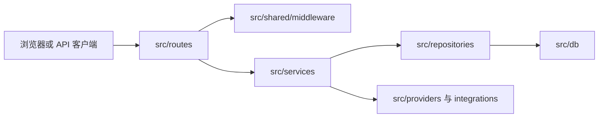

ShipGo 是基于 TanStack Start 的全栈 TypeScript 应用。产品行为保留在 Service 与
Repository 中，外部系统通过 Provider 接口隔离。

## 技术栈

| 层级 | 技术 | 用途 |
| --- | --- | --- |
| 框架 | TanStack Start + React 19 | 全栈路由、SSR 与 UI |
| 构建 | Vite + Nitro | 开发服务器与可移植生产输出 |
| 样式 | Tailwind CSS | 原子化样式系统 |
| 数据库 | PostgreSQL + Drizzle ORM | Schema、迁移与类型安全 SQL |
| 认证 | Better Auth | 认证、会话与 API Key |
| 支付 | Stripe / Creem | 订阅、终身套餐与积分购买 |
| 邮件 / Newsletter | Resend / Beehiiv | 事务邮件与 Newsletter |
| 内容 | Fumadocs + Intlayer | 文档、内容与国际化 |
| 运行时 | Node.js 24 | 生产运行时 |
| 本地编排 | Docker Compose | 本地应用与 PostgreSQL |
| 测试 | Vitest | 单元与集成测试 |
| 质量 | Biome | 格式化与静态检查 |

## 目录布局

<Files>
  <Folder name="content" defaultOpen>
    <Folder name="docs" />
    <Folder name="blog" />
    <Folder name="legal" />
    <Folder name="changelog" />
    <Folder name="roadmap" />
  </Folder>
  <Folder name="drizzle" />
  <Folder name="public" />
  <Folder name="scripts" />
  <Folder name="src" defaultOpen>
    <Folder name="config" />
    <Folder name="core" />
    <Folder name="db" />
    <Folder name="integrations" />
    <Folder name="providers" />
    <Folder name="repositories" />
    <Folder name="routes" />
    <Folder name="services" />
    <Folder name="shared" />
  </Folder>
  <File name=".env.example" />
  <File name="docker-compose.yaml" />
  <File name="Dockerfile" />
  <File name="source.config.ts" />
</Files>

## 请求处理链



Route 验证 HTTP 输入并选择响应；Service 执行产品规则；Repository 读写数据；
Provider 与外部系统通信。

架构遵循单向依赖结构：

```text
Route / API -> Server Action / Middleware -> Service -> Repository -> PostgreSQL
                                      \-> Provider -> External service
```

核心业务规则不应写在 React 组件或 API 路由中。支付、积分与认证写入必须按场景
保持幂等，并使用事务保证一致性。

## 数据库边界

Drizzle Kit 只发现 `src/db/schema.ts`。该文件导出八张生产表：`user`、`session`、
`account`、`verification`、`apikey`、`shipgo_billing_order`、`shipgo_credit_wallet` 与
`shipgo_credit_ledger`。

| 文件 | 数据表 |
| --- | --- |
| `src/db/auth.schema.ts` | `user`、`session`、`account`、`verification`、`apikey` |
| `src/db/app.schema.ts` | `shipgo_billing_order`、`shipgo_credit_wallet`、`shipgo_credit_ledger` |

认证表需要符合 Better Auth 兼容要求。不要把动态配置、RBAC、订单、订阅、Waitlist
或其他积分表加入生产 Schema 文件。正式切换前，请对生产数据库副本执行
`pnpm db:check-compat`。

## 修改应放在哪里

| 修改内容 | 主要位置 |
| --- | --- |
| 添加页面或 API | `src/routes` |
| 添加复用 UI | `src/shared/components` |
| 添加产品行为 | `src/services` |
| 添加数据库查询 | `src/repositories` |
| 新增或修改数据表 | `src/db` 加 `drizzle/` 迁移 |
| 修改产品名、功能或 Provider | `src/config/site-config.ts` |
| 修改套餐或积分包 | `src/config/business-config.ts` 与 `src/config/payment-config.ts` |
| 添加翻译后的界面文本 | `src/config/locale/*.content.ts` |
| 添加文档或博客 | `content/docs` 或 `content/blog` |
| 集成外部服务 | `src/integrations` 或 `src/providers` |
| 添加运维命令 | `scripts` 与 `package.json` |

## 路由

TanStack Router 根据 `src/routes` 生成路由树。

- `src/routes/{-$locale}` 包含支持语言的页面；可选语言段让默认语言 URL
  保持简洁。
- `_main` 和 `_landing` 是不出现在 URL 中的布局分组。
- `src/routes/api` 包含服务端 Handler。
- `sitemap[.]xml.ts` 等文件使用方括号转义 URL 中的点号。

Route 应保持精简：解析输入、应用 Middleware、调用 Service、格式化响应。

## 配置

ShipGo 把配置分成三类：

1. **代码中的产品配置：** 网站元信息、功能开关、Provider、套餐、价格和积分。
2. **本地化文案：** `src/config/locale` 中的 Intlayer 字典。
3. **密钥和环境专属值：** 本地放在 `.env.local`，生产环境放在部署平台。

这种分离可以避免密钥进入 Bundle，并让产品修改可接受代码审查。

## 内容

`source.config.ts` 声明 Fumadocs 内容集合。文档、博客、作者、分类、法律页面、
路线图和更新日志会在 `pnpm content:build` 时编译。

本地化 MDX 的英文文件使用 `.mdx`，中文文件使用 `.zh.mdx`：

```text
content/blog/welcome-to-shipgo.mdx
content/blog/welcome-to-shipgo.zh.mdx
```

## 测试与发布脚本

测试放在被验证代码附近。运维和发布流程放在 `scripts/` 中，`package.json`
为其提供固定命令名。发布前应使用 `pnpm verify:release`，不要手动挑选部分检查。

## 验证契约

每次结构性或兼容性变更都必须保持以下命令通过：

```bash
pnpm check
pnpm deps:check
pnpm typecheck
pnpm test
pnpm build
```

生产切换还要求 `pnpm db:check-compat`、`pnpm test:integration`、有效签名 Webhook
Fixture 回放，以及 `pnpm smoke:release`。
